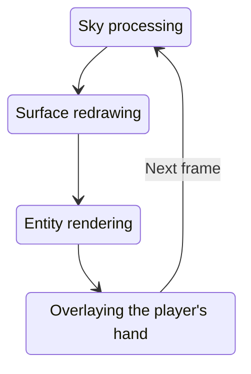

# Threading

Multithreading is of paramount importance for any modern system, environment, application, and simply for a script. But not in the case of Minecraft. This game uses one thread for practically everything: rendering interfaces, world generation, rendering entities, and more. So far this works identically on all editions of the game, creating performance issues and raising system requirements. But is everything really so bad and when can you use multiple threads, and also, why do we even need this. Let's figure it out.

## What is a thread

Many may have immediately noticed a new term for themselves, so if you haven't yet gone looking for it on the network, let's consider it in the simplest possible theme. A thread is engaged in the sequential processing of processes assigned to it. Don't worry, let's just look at a real example, so everything will become clearer.

So, imagine the rendering loop of the game world:



Starting with sky processing, we end with overlaying the player's hand, starting all over again and again, and so on as long as the world is being used by the player. These are four completely different and unrelated processes. However, they do have something in common. They will be processed by a single thread. This means that the processes will be executed one after another, sequentially, and none of them can be completed earlier than the other.

Coming to the concept of multithreading, one might think that processes will simply run in different threads. And this could be true, but most likely several threads will be needed for different types of tasks, rather than specific processes. The fact is that any process consists of actions — those lines of code that are in your script. And usually programmers separate resource-intensive tasks (that do not require urgent processing) into separate processes, leaving the main thread unloaded to perform less complex work faster.

The game world processes everything together using only one thread. This brings some number of limitations for us, because performing actions parallel to each other is simply not provided in most cases, and separate threads are processed exactly in this way. Minecraft is not asynchronous (cannot process processes in parallel), so let's look exactly at how this will affect us.

## Creating processes

Multithreading is created through Java constructs, the platform is optimized for launching threads. Why use them? There are a ton of options — from processing information to animating interfaces. It's only up to you to decide here, and we cannot give any recommendations, I advise you to study a [third-party article](https://habr.com/ru/sandbox/167189).

Let's start by creating a simple thread imitating work. In general, threads are created using the method:

```js
Threading.initThread(name, action, priority?, isErrorFatal?, formatFunc?)
```

Where `name` defines a string identifier, and `action` describes the process performed by the thread. Let's run a resource-intensive task as an example:

```js
Threading.initThread("mod_testProcess", function() {
    alert("Starting process");
    for (let i = 0; i <= 5; i++) {
        java.lang.Thread.sleep(4000);
        alert((i / 5 * 100) + "%");
    }
    alert("Done!");
})
```

Although instead of a task we simply "put to sleep" the thread for 4 seconds. The thread identifier can be anything, but it is better to stick to something like *shortmodname_processDescription* (for example, `tcon_crafting`). Experiment with different tasks, we will repeatedly touch upon threads in the future.

Following the call of this method, the created thread object can be obtained by name using `getThread`. The thread object is its handler, let's highlight the key methods here:

```js
const thread = Threading.getThread("mod_testProcess");
if (thread) { // the process might already be completed
    const another = Threading.initThread("mod_asyncProcess", function() {
        while (thread.isAlive()) { // the process might already be completed
            // interruption with minimal time period
            java.lang.Thread.yield();
            // join can be used as an alternative
        }
        alert("Previous thread completed!");
    });
    if (!another.isInterrupted()) {
        // interrupting the thread will cause an error inside it
        // if sleep or yield is used; if the
        // thread is already sleeping, the error will be thrown immediately
        another.interrupt();
    }
}
```

Most of these methods can be called in the current thread using `java.lang.Thread.*` (where * is the method name). Or vice versa, `java.lang.Thread` methods can be called on the handler object.

So in what cases should threads definitely not be used?

- Placing blocks, summoning entities, changing their attributes, and so on
- Obtaining information about the game world, entity attributes, blocks, and so on
- Any actions related to the native part, if it affects the game

You can never know exactly what project might cause thread issues, the result of their constant use is unknown and unique for each case. Better use [updatables](updatables), they are predictable and do not cause desynchronizations. And threads should not be used to interact with the game at all.

### Real-world examples

In these projects you can look at undesirable implementations, or conversely, examples suitable for use in your mods, as well as libraries to extend thread functionality.

<!-- Expand this list yourself as needed. -->

1. Unstable (threads are not used as intended)

   1. AdvancedEvents library — getting data about the world and entities, the events themselves are not asynchronous with the game
   2. StructuresAPI and Dungeon Utility libraries — placing blocks, changing containers of native tiles
   3. BookModel library — changing animation render meshes
   4. Transition library — changing attributes and position of entities
   5. Bow library — changing the player's viewing angle
   6. Aim Assist — getting data about the world, its entities and changing the rotation angle of entities
   7. Utils+ and EnderIO — searching for nearby containers and blocks to obtain energy
   8. Tinkers' Construct — breaking and obtaining blocks, changing animation renders
   9. Super stone sword — deleting entities and obtaining their attributes
   10. Sparks Hammers — breaking blocks
   11. Ex Nihilo Origin — placing blocks, changing entity position
   12. random_drop — getting entities and their attributes, deleting and changing
   13. Minimap — getting data about the world, its blocks and entity attributes
   14. Minechemistry — changing parts of animation renders
   15. Landslide Mod — getting, breaking and placing blocks
   16. Direction HUD — getting the rotation angle of entities

2. Excellent examples of usage

   1. Action library — using tick-like threads based on conditions with a lifecycle and stop
   2. Sequence library — using resource-intensive threads in conjunction with interface updates
   3. ScrutinyAPI library — using interpolation to create achievement interface animation
   4. workbench library — updating the list of workbench recipes with subsequent opening
   5. Connectivity library — asynchronous file upload and download, as well as reading information from the network
   6. RefinedStoragePE — processing a workbench container with data synchronization between client and server
   7. Backups — asynchronously generating the interface of the worlds list with subsequent updating
   8. Recipe Viewer — creating text animations in the interface and asynchronous data loading
   9. We will bedrock U — searching for the nearest magic zone with complex calculations
   10. Divine Favor — checking for updates from a remote repository
   11. ModBrowser — creating text animations in the interface

## System interface

In addition to the in-game interface, engine containers and windows, there is the possibility of using the Android API to develop interfaces based on it.

```mdx-code-block
import NotImplemented from "@site/src/components/NotImplemented"

<NotImplemented />
```
