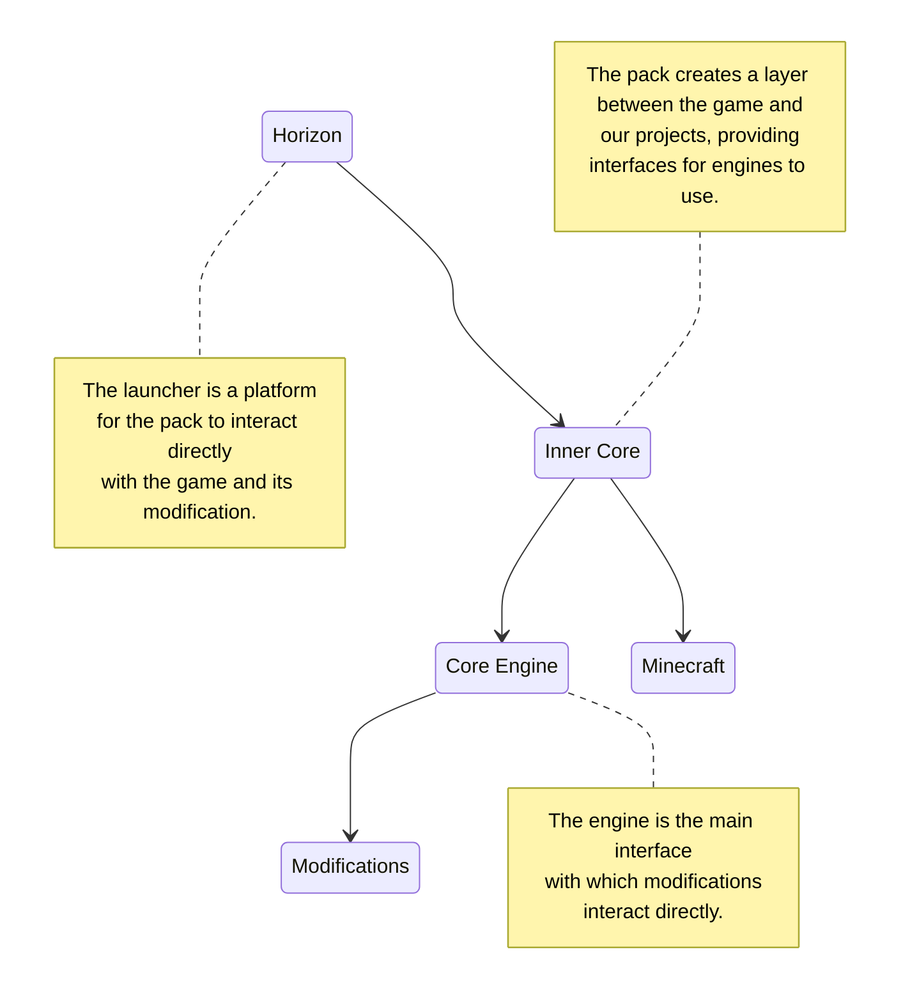

# Methodology

Any project one way or another has some summary of basic terms, in which any of us should easily navigate, not forgetting basic concepts. It is important to remember that Minecraft is a game that encourages creativity and freedom of action, so there are no strict rules or limitations in methodology. However, one can describe the general steps and approaches that can be used when playing or creating mods for it.

## Game Environment

Let's start with what a newly user-created world in Minecraft consists of in general:

1. Blocks — are the main building materials in the world. They represent various cube-like cells, such as dirt, stone, wood, ores, tiles, and others. Blocks can be broken, moved, and used to create various structures, mechanisms, or even structures.

2. Items — there are many different items that can be crafted, found, or obtained in the game. This includes tools, weapons, armor, food, resources, and much more. Items can be used to perform various tasks, such as mining other items, fighting mobs, or even building.

3. Mobs — these are entities that inhabit the game world. They can be friendly, for example, villagers, or hostile, for example, zombies or creepers. Mobs can attack the player or other mobs, as well as perform various actions, like pollinating flowers by bees.

4. World Generation — the world is procedurally generated, which means that each new world is created randomly. This includes generating terrain, caves, rivers, trees, structures like villages, and more. The terrain is divided into various unique terrain areas, such as forests, deserts, mountains, plains, and similar, called biomes. Each biome has its own unique features, vegetation, climate, and resources.

5. Game Modes — survival, creative, and adventure. Each mode implies different rules and goals, allowing players to choose the experience that best suits their preferences.

These are just basic aspects, each of which will be further discussed within this documentation. The game offers endless possibilities for exploration, building, and adventures, which anyone can expand after diving into the following articles.

## What a project consists of

A project is a certain abstraction, an idea that needs to be implemented:

1. Concept and Design — the initial stage where the developer defines the idea and concept of the mod. They decide what new elements or functions will be added to the game and how they will interact with existing aspects.

2. Code Development — this stage involves programming the new functions and elements of the mod. The developer uses a programming language to create the necessary classes, methods, and algorithms.

3. Creating Textures and Models — visual aspects of the mod, such as block and item textures, animations, and mob models, which are usually developed using graphic tools.

4. Testing and Debugging — before development is completed, the mod must be thoroughly tested for errors and bugs. The developer must ensure that the mod works correctly and is compatible with other mods and game versions.

5. Compilation and Publishing — after successful testing, the mod must be packaged in the appropriate format and distributed via the built-in browser.

## Engine, Pack, and Launcher

Every project one way or another utilizes game interfaces (API — Application Programming Interface), which facilitate mod development. For them to be directly accessible to developers, there are packs that are launched directly by the launcher, pre-loading the game. It's not entirely clear, I know, it's better to look at it on a standard diagram for most projects:

This topic will be touched upon repeatedly, but for now we will limit ourselves to a couple of terms. Neither the original authors of the game, nor the creators of the launcher or documentation relate to each other. Send any errors and suggestions only to those who represent this or that resource, or the community.

## What are mods and modpacks

A mod, or *modification*, literally means changing the gameplay process by adding or making edits to existing content. Any element of the [game environment](#game-environment) can be used to expand and change the gaming experience, adding new capabilities. In Inner Core engines, mods are conventionally called folders containing resources, like textures and description files, scripts describing the logic of executed algorithms during the game, and settings for the operation of these algorithms.

A *modpack* means a certain number of mods, usually combined by additional mods to add integrations between them. Each modpack has its own list of worlds, as well as settings for the installed mods. Custom modpacks can be created directly in the launcher interface, usually simply to separate the list of worlds and mod sets for different purposes.
