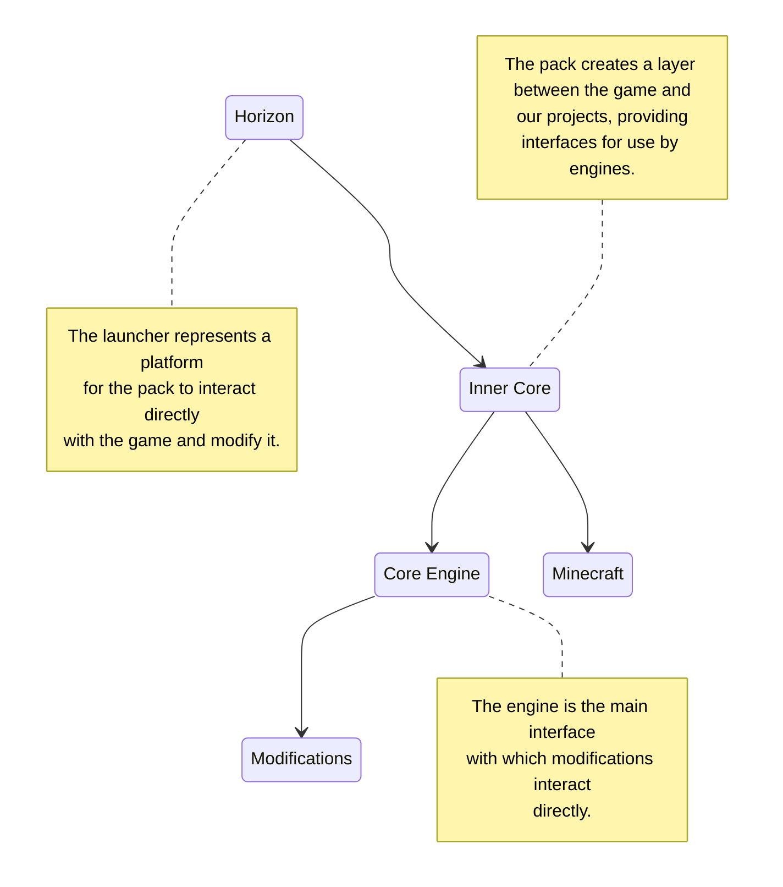

# Methodology

Any project somehow has a summary of basic terms, in which any of us must swim freely, not forgetting the basic concepts. It is important to remember that Minecraft is a game that encourages creativity and freedom of action, so there are no strict rules or limitations in the methodology. However, general steps and approaches can be described that can be used when playing or creating mods for it.

## Game Space

Let's start with what a newly created user world in Minecraft generally consists of:

1. Blocks — are the main building materials in the world. They represent various cube-like cells, such as dirt, stone, wood, ores, tiles, and others. Blocks can be destroyed, moved, and used to create various structures, mechanisms, or even structures.

2. Items — there are many different items that can be created, found, or obtained in the game. This includes tools, weapons, armor, food, resources, and much more. Items can be used to perform various tasks, such as obtaining other items, fighting mobs, or even building.

3. Mobs — these are creatures that inhabit the game world. They can be friendly, for example, villagers, or hostile, for example, zombies or creepers. Mobs can attack the player or other mobs, as well as perform various actions, like pollinating flowers by bees.

4. World Generation — the world is generated procedurally, which means that each new world is created randomly. This includes the generation of terrain, caves, rivers, trees, structures like villages, and so on. The landscape is divided into various unique terrain areas, such as forests, deserts, mountains, plains, and similar, called biomes. Each biome has its own unique features, vegetation, climate, and resources.

5. Game Modes — survival, creative, and adventure. Each mode implies different rules and goals, allowing players to choose the experience that best suits their preferences.

These are just basic aspects, each of which will be further discussed in the vastness of this documentation. The game offers endless possibilities for exploration, construction, and adventure, which everyone can expand after immersing themselves in the following articles.

## What a Project Consists Of

A project is a certain abstraction, an idea that needs to be implemented:

1. Concept and Design — the initial stage where the developer determines the idea and concept of the mod. He decides what new elements or functions will be added to the game and how they will interact with existing aspects.

2. Code Development — this stage involves programming new functions and mod elements. The developer uses a programming language to create the necessary classes, methods, and algorithms.

3. Creating Textures and Models — visual aspects of the mod, such as block and item textures, animations, and mob models, which are usually developed using graphic tools.

4. Testing and Debugging — before completing development, the mod must be thoroughly tested for errors and bugs. The developer must ensure that the mod works correctly and is compatible with other mods and game versions.

5. Compilation and Publication — after successful testing, the mod must be packed into the appropriate format and distributed via the built-in browser.

## Engine, Pack and Launcher

Every project somehow involves game interfaces (API — Application Programming Interface), which facilitate mod development. To make them available to developers directly, there are packs launched directly by the launcher, pre-loading the game. Not entirely clear, I understand, let's look at this in the standard scheme for most projects:

This topic will be touched upon more than once, but for now, we will limit ourselves to a couple of terms. Neither the original authors of the game, nor the creators of the launcher or documentation relate to each other. Send any errors and suggestions only to those who represent a particular resource or community.

## What are Mods and Modpacks

A mod, or *modification*, literally means changing the game process (gameplay) by adding or making edits to existing content. Any element of the [game space](#game-space) can be used to expand and change the gaming experience, adding new features. Mods on Inner Core engines are usually called folders containing resources, such as textures and description files, scripts describing the logic of executable algorithms during the game, and settings for the operation of these algorithms.

By *build* (modpack), we mean a certain number of mods, usually combined with additional mods to add integrations between them. Each build has its own list of worlds, as well as settings for installed mods. Custom builds can be created directly in the launcher interface, usually simply to separate the list of worlds and mod sets for different purposes.
