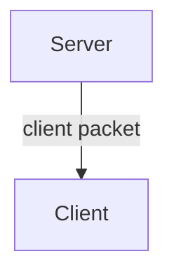

# Client Packets
<!-- Looks like we meet again! Welcome client, the story will be interesting. -->
Client packets are one of the things that almost no magic mod can do without.

In this article, we will figure out what client packets are for, how to use them, and consider their application with a practical example.

<!-- Once upon a time there was a server, and everything was calm for him. He, as usual, controlled the world, changed day and night, placed blocks as he wanted. He didn't expect guests and was lonely, this was his curse. One wonderful day a miracle happened, he met clients. But the sadness didn't leave him, he couldn't communicate with them, even though he really wanted to. He invented packets, and thought, suddenly this would help, suddenly they would be able to talk! But the clients misunderstood his intention. They were afraid of him, it was raining outside, drops descending from the old wooden roofs of village houses. Closer to the night, thunder struck, the clients cowered in fear. They didn't see the server, they were afraid of him. But there was a brave one who decided that he wanted to communicate with the server, suddenly all the rumors were unjustified, suddenly the server was a friend. He went out into the street in the morning, called the server, and then a packet came to him... -->

## What are client packets

Client packets are functions that are sent <u>from the server to the client</u> and are executed there, accepting data upon sending. They are a way for the server to communicate with players and are very useful.



To send a packet, we need to get a client object. <u>Only client packets</u> are always sent to the client.

## Methods

Let's start with the methods:

```ts
//got the client object of a specific player
Network.getClientForPlayer(player id);

//got the client objects of all players
Network.getConnectedClients(); 

//will send a packet from the server to all clients
Network.sendToAllClients(name, data: object);

//will add a client packet
Network.addClientPacket(name, func: (data: object) => void); 

//will send a message to all clients
Network.sendServerMessage(text);

//will convert a server id into a local one (the one on the client)
Network.serverToLocalId(id: string | number);

//will send a packet from the server to the client
<NetworkClient>.send(name, data: object); 

//will send text to the client in chat
<NetworkClient>.sendMessage(text); 
```

We could break down client packets based on an example of a banal text sending to chat, but let's be more creative! Remember, we wrote an [animation of spending money](../ui/advanced/animating-elements)? Let's apply it. We will call it with a number, which will be the new level of experience that the player received.

## Creating a packet

Our packet will run an animation on the client with the text coming from the packet data. In our example, we will use TypeScript, but only to demonstrate the incoming data.

```ts
Network.addClientPacket("packet.example.start_animation", (data: { text: string }) => {
    if(!data.text) {
        return; //if we didn't receive data, the animation will not appear
    }
    animator.init(data.text); //start the animation
});
```

## Using the packet

Let's send our packet from the server to the client by the packet name and pass the level data as text for the animation.

```js
Callback.addCallback("ExpLevelAdd", (level, playerUid) => {
    const client = Network.getClientForPlayer(playerUid); //got the client object in the server callback.
    if(client != null) {
        client.send("packet.example.start_animation", { text: level }); //sent data by packet name to the received client
    }
});
```

:::note Why don't we just run the animation in a server callback?
The fact is that we need to run it on a specific device, for a specific player.
:::

:::warning Always check that the client object is not equal to null

This will help avoid rare errors.

:::

## Id Synchronization

Imagine we are sending data about an item id from the server to the client. Let's use TypeScript again for demonstration.

```ts
Network.addClientPacket("packet.example.sync_id", (data: { id: number, count: number, data: number, extra?: ItemExtraData }) => {
    const id = data.id //what's wrong?
});
```

The code seems correct, but the id on the server and on the client may differ. Let's get the correct id using the ``Network.serverToLocalId`` method and display the item particle above the player.

```ts
Network.addClientPacket("packet.example.sync_id", (data: { id: number, count: number, data: number, extra?: ItemExtraData }) => {
    const id = Network.serverToLocalId(data.id);
    const position = Entity.getPosition(Player.getLocal());
    Particles.addBreakingItemParticle(
        id, //item id
        0, //particle data
        position.x + 0.5, //in the middle by x 
        position.y + 2, //2 blocks above the player's position by y
        position.z + 0.5 //in the middle by z
    );
});
```

If you have no questions left, I can congratulate you! And if not, you can always re-read the article and practice.
Here are a few tasks for you in ascending order of difficulty:

1. Write a client packet that will print the name of an item to the chat. To get the name, you can use the ``IDRegistry.getNameByID(id: number)`` method.
2. Write a method that will print the names of all players to the chat on the client.
3. Write your own simple animation that will display the names and the amount of health of all players on the client.
4. Write a method that will sort the inventory by dimension id. For example, if the player is in the overworld, all items will be dropped except those that display some dimension numbers. For example, if the dimension is the overworld, the item will be placed in the slot number 1 (if possible, otherwise to the closest possible), because the dimension id is 1. After that, send a packet to the client and notify it about the sorting via [``Game.tipMessage(text)``](/api/namespace/Game#tipMessage), reporting which items were laid out and by which dimension.
