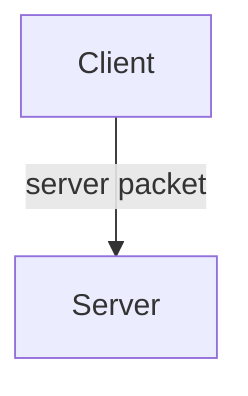

# Server Packets

Oh, you're back here. Thank you for reading us!

In previous articles we analyzed client packets, and multiplayer seemed quite simple. From this moment on, the material will become more difficult, work with security begins, packets will have to be protected. Read very carefully.

We will write a small mechanic of the learning system, and we will try to misuse its packets. We will gradually rewrite our packets to provide decent security. We will also try to identify and immediately kick violators.

## What are server packets

Server packets are functions that are sent <u>from the client to the server</u> and are executed there, accepting data upon sending and providing the object of the client that sent it. They are a way for the client to communicate with the server and are very useful.



## Methods

```js
//will send a server packet from the client
Network.sendToServer(name, data: object);

//will add a server packet
Network.addServerPacket(name, func: (client: NetworkClient, data: object));

//will return a list of player uids on the server
Network.getConnectedPlayers();

//will convert a local id into a server one
Network.localToServerId(id: string | number);

//will return the uid of the player to whom the client object belongs
<NetworkClient>.getPlayerUid();

//will exclude the player from the world, use with caution
<NetworkClient>.disconnect(reason); 
```

## Writing a simple learning system

### Writing the database and learnings

```js
const Manager = {
    learnings: ["construction", "table", "wall_break", "furnace", "tool"],
    registerLearning(name) {
        this.learnings.push(name);
    },
    players: {},
    addLearningFor(playerUid, name) {
        this.players[playerUid] = this.players[playerUid] || []; //add the player to the database if they don't exist
        this.players[playerUid].push(name);
    },
    sendFor(playerUid) {
        const client = Network.getClientForPlayer(playerUid);
        if(client != null) {
            client.send("packet.example.sync_learnings", this.players[playerUid]); //we will write the packet a little later
        }
    }
}
```

### Writing data saving

Great, we have a database. Now let's write [data saving](../storage/saving-basics) for the learnings of our players.

```js
Saver.addSavesScope("scope.example.learnings", 
    function read(scope) {
        return scope ? scope : {} //if we saved data earlier, read it, otherwise supply an empty object
    },
    function save() {
        return Manager.players || {}; //write our Manager.players object to the scope if there are no errors, otherwise an empty object
    }
);
```

### Writing sending data about player's learnings to the client

Let's write a client packet that will send data about learnings from the server to the client and record them for it. Do not forget that the values in variables on the client and on the server are not connected.

Since data is an object, and an array is an object, we will send an array at once.

```ts
Network.addClientPacket("packet.example.sync_learnings", (data) => {
    Manager.players = Manager.players || {}; //create an object for data if it was deleted
    Manager.players[Player.getLocal()] = data; //got the player's id on the client and wrote the incoming data to the client.
});
```

:::info Why not just send the player the data about the learnings of all players?

The player doesn't need to know what learnings other players have in this case. Do not send data that won't be useful.

:::

Let's write sending data to the player upon joining.

```js
Callback.addCallback("ServerPlayerLoaded", (playerUid) => {
    if(!(playerUid in Manager.players)) {
        Manager.players[playerUid] = [];
    }
    Manager.sendFor(playerUid);
});
```

### Writing a packet for issuing the "wall_break" learning

Imagine we have an abstract block "magic_wall". We need to issue the "wall_break" learning on the DestroyBlockContinue event. But this is a client event. What should we do? The server packet comes to the rescue. It will send a request from the client to the server, which will ask to issue the learning to the sender.

```js
Network.addServerPacket("packet.example.wall_break_learning", (client, data) => {
    const playerUid = client.getPlayerUid();
    if(Manager.players[playerUid].includes("wall_break")) {
        return; //terminate the function if the player already has the learning
    }
    Manager.addLearningFor(playerUid, "wall_break");
    Manager.sendFor(playerUid);
});
```

Moving on to the interesting part!

```js
Callback.addCallback("ItemUseLocal", () => {
    Network.sendToServer("packet.example.wall_break_learning", {});
});
```

Oops! And here the packet has already been misused by a cunning developer. And now imagine if packets accept the ids of other players in data, this way a bad developer could completely ruin important data on some server. From the moment your mod becomes available for multiplayer, protecting packets becomes one of the most important tasks for you. By the way, let's protect it!

```js
Network.addServerPacket("packet.example.wall_break_learning", (client, data) => {
    const playerUid = client.getPlayerUid();
    if(Manager.players[playerUid].includes("wall_break")) {
        return; //terminate the function if the player already has the learning
    }
    const position = Entity.getPosition(playerUid);
    const region = BlockSource.getDefaultForActor(playerUid);
    let kick = true;

    for(let x = position.x - 6; x <= position.x + 6; x++) {
        for(let y = position.y - 6; y <= position.y + 6; y++) {
            for(let z = position.z - 6; z <= position.z + 6; z++) {
                if(region.getBlockID(x, y, z) == BlockID["magic_wall"]) {
                    kick = false;
                    break;
                }
            }
        }
    }
    if(kick == true) {
        client.disconnect("cheating");
        return;
    }
    Manager.addLearningFor(playerUid, "wall_break");
    Manager.sendFor(playerUid);
});
```

When a packet arrives at the server, we check whether the player could actually start breaking this block, whether they were in an area where they could reach it, or not. If not, we understand that this is probably a cheater and kick them. Also, if the player already has the learning, we just exit the function.

:::danger Always protect packets

Even a simple-looking packet can bring huge problems in the future if poorly protected.

:::

In general, for each server packet you will <u>always</u> have to write protection, and above you saw one of the examples of its implementation. Let's finish our idea and send the packet in the callback we need.

```js
Callback.addCallback("DestroyBlockContinue", (coords, block, progress) => {
    if(block.id == BlockID["magic_wall"]) {
        Network.sendToServer("packet.example.wall_break_learning", {});
    }
});
```
