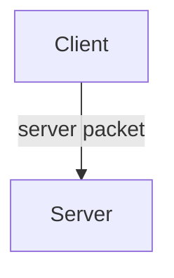
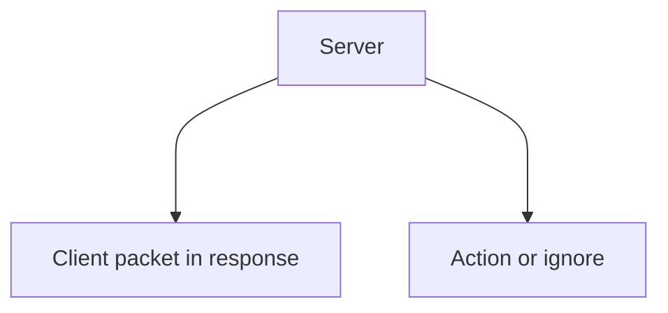

# Getting Started

Multiplayer is one of the most important parts of any **non-client mod** that the creator needs to support so that players can play the mod together. And at the same time, one of the most difficult for beginners.

Let's try to figure out in one article how to distinguish between client and server and what is the difference between them, what packets are needed for, and determine which [events](../events/callbacks) are client and which are server ones.
Before reading the article, I strongly recommend that you familiarize yourself with the following articles, because the materials from them will be considered in this section:

1. [Callbacks](../events/callbacks)
2. [Containers](../storage/containers)
3. [Tile Entities](../storage/tile-entities)
4. [Saving Data](../storage/saving-basics)

## Client

Let's try to understand this right away using the game as an example. Imagine that we are on a server. All players are clients. They cannot affect the server directly, but they can send requests (packets), and the server can either take some action, for example, send a response packet, or ignore or take some actions against the client if it considers it necessary.

In case the server wants to send some data to the client, it will send a response packet, and such a packet will be called [client](client-packets).

Clients only know the information they need. For example, this is data about mobs and blocks in the chunks loaded by them, weather, and time.

Let's imagine that we are writing a mod and as an ordinary player on the server we are trying to get data about connected players using [`Network.getConnectedPlayers()`](/api/namespace/Network#getConnectedPlayers). Since the client does not know this information, we will not get the list we need. However, we can create a server packet that we will send to it, and it will perform the actions we need with the player list itself. Why don't we just send the player list to the server? This can be dangerous, and we will talk about the security of packets in the future.

Distribute the load so that all visual information is calculated on the client.

Methods that provide information to clients are usually called ***client***, and those that change server information are called ***server***.

The client cannot use server methods, for example, break and place blocks using [BlockSource](/api/class/BlockSource).

### Difference in data

As we said earlier, the game does not give out data that the client shouldn't know. When we change data inside our mod on the host (the player who owns the world or server software), it only changes on the server. But on the client it remains the same. Usually, the server provides the necessary information to clients using packets or [SyncedNetworkData](../events/using-synced-data).

:::danger Do not store information important to the game on the client
All important information that does not concern the visual part should be handled by the server.
:::

## Server

A server is a computer running a Minecraft world. It can directly interact with the world and the data stored on it, change player data from mods, for example, such as: learnings, magic level, and so on. The server does not know information from the client unless it is sent via [server packets](server-packets).
All the load that doesn't concern the visual part should fall on the server. These are various systems added by mods, the functionality of blocks, and so on.

Packets that the server receives are called [server](server-packets). It is very important to understand that fair packets may not always arrive at the server; some mods may send packets with arbitrary data from an unscrupulous developer, which, of course, must be taken into account. We'll talk about security in the article about server packets, but for now just remember this.

## Good and bad examples

Let's look at good and bad examples of multiplayer implementation:

1. Bad examples
   1. A tile entity spawns particles not inside [client.onTick](/api/namespace/TileEntity#LocalTileEntityPrototype), but sends a packet to the client with the start of particles.
   2. One packet is used for many actions, for example, for loading, destroying, changing position and texture for [Animation](/api/namespace/Animation).
   3. Instead of creating a packet for launching a particle shape ([by the way, we looked at them here](../environment/particles)), the same packet is sent to spawn one particle many times to draw the same shape.
2. Good examples
   1. The client part of the tile entity is separated from the server and the data is supplied using SyncedNetworkData.
   2. The code is competently divided into packets; a packet does not do more than necessary, so as not to overload the server unnecessarily.

:::warning Don't skimp on packets

The number of packets is not important; try to ensure that they do not do more than is required to solve a specific task.

:::

## Client and server events

Classification of events into client and server; if an event is in both columns, it means it is called for both the server and client parts:

### Per-tick events

| Client | Server |
|---|---|
| tick | |
| LocalTick | |
| LocalPlayerTick | ServerPlayerTick |

### Mob spawn in the world

| Client | Server |
|---|---|
| EntityAddedLocal | EntityAdded |
| EntityRemovedLocal | EntityRemoved |
| LocalPlayerLoaded | ServerPlayerLoaded |

### Player changed dimension

| Client | Server |
|---|---|
| LocalPlayerChangedDimension | PlayerChangedDimension |
| | CustomDimensionTransfer |
| DimensionLoaded/Unloaded | |

### Changing blocks

| Client | Server |
|---|---|
| DestroyBlockStart | DestroyBlock |
| DestroyBlockContinue | |
| | BuildBlock |
| | BlockChanged |
| | BreakBlock |
| | PopBlockResources |
| | BlockEventEntityInside |
| | BlockEventEntityStepOn |
| | BlockEventNeighbourChange |
| | RedstoneSignal |
| | TileEntityAdded/Removed |

### Using items

| Client | Server |
|---|---|
| ItemUseLocal | ItemUse |
| ItemUseLocalServer | ItemUseServer |
| | ItemUsingReleased |
| | ItemUsingComplete |
| ItemUseNoTarget | |
| LocalPlayerEat | ServerPlayerEat |
| FoodEaten | FoodEaten |
| | ItemDispensed |

### Mob actions

| Client | Server |
|---|---|
| EntityHurt | EntityHurt |
| | PlayerAttack |
| | EntityInteract |
| | Exp(Level)Add |
| | ExpOrbsSpawned |
| | EntityPickUpDrop |
| | Explosion |
| | EntityDeath |
| | ProjectileHit |

### World generation

| Client | Server |
|---|---|
| | GenerateChunk and others |
| | Pre/PostProcessChunk |
| | GenerateBiomeMap |

### Actions in UI

| Client | Server |
|---|---|
| CustomWindowOpened/Closed | ContainerOpened/Closed |
| NativeGuiChanged | |
| SystemKeyEventDispatched | |
| NavigationBackPressed | |
| AppSuspended | |
| OptionsChanged | |
| All game loading stages | |

### Other events in the world

| Client | Server |
|---|---|
| NativeCommand | |
| ItemName/IconOverride | |
| CustomBlockTessellation | |
| VanillaWorkbenchRecipeSelected | |
| | CraftRecipe(Pre)Provided |
| | VanillaWorkbench(Post)Craft |
| | EnchantPostAttack/Hurt |
| | EnchantGetDamage/ProtectionBonus |
| | Read/WriteSaves |
