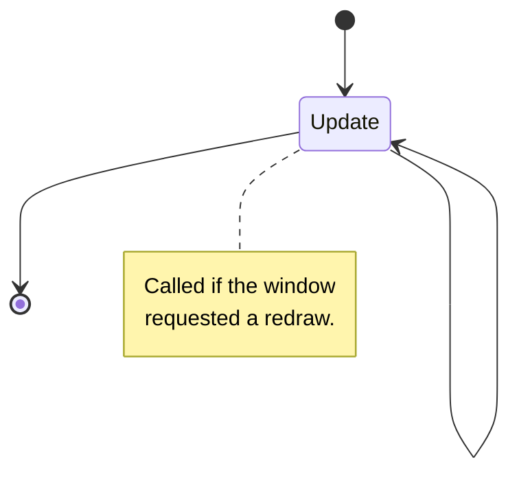

# Background layout

Forms the window space, visually indicating its boundaries and adding background objects as needed. These components are always under the main elements, and like any other components, are drawn on the canvas as the content of your window.

## Life cycle



The entire cycle comes down to updating (redrawing the component, the first drawing also calls it) if such was requested. For this, the [invalidateDrawing](/api/namespace/UI#invalidateDrawing) function of the window or [invalidateUIDrawing](/api/namespace/UI#invalidateUIDrawing) of the container is used.

The background layout has no events, even extendable components can only be drawn. That's why they are static components, so as not to interact with anything.

## Component varieties

Background components are defined by the `drawing` array of the window description object. They do not have identifiers and can only be updated all together.

```js
new UI.Window({
    ...
    drawing: [
        // component description object
        {
            type: "component", // required property
            ...
        },
        ...
    ]
})
```

There can be any number of component description objects, they will be drawn one after another, starting with the first.

### Fill

<div className="resource-atlas-align-box">


</div>

Fills the entire content of the window with the specified color, can be translucent. Adding a transparent (`0`) fill will add a transparent background to the window (by default it is black).

```js
{
    type: "color",
    color: android.graphics.Color.WHITE
}
```

This will fill the entire window background with white. Besides standard colors, like `GREEN`, `RED` or `BLUE`, colors are usually set using the `argb` method:

```js
android.graphics.Color.argb(127, 255, 255, 255)
```

To set transparency, red, green and blue colors respectively. The method accepts integer values from 0 to 255, or fractions from 0 to 1. Often hex values are used to set the color:

```js
android.graphics.Color.parseColor("#88ffffff")
```

When using the `mode` property, the blending mode will allow you to overlay the color with a specific mask. You can read more about blending modes [here](https://developer.android.com/reference/android/graphics/Shader.TileMode#alpha-compositing-modes).

### Images

<div className="resource-atlas-align-box">


</div>

Displays an image from the resources of the engine's interface folders, using the specified dimensions, or occupying the number of pixels in the image. Often used to visually indicate the background of slots and scales.

```js
{
    type: "bitmap",
    x: 40, y: 0,
    bitmap: "icon_menu_innercore"
}
```

By default, images are drawn with the same number of pixels that are in the selected texture. To change this behavior, manually set the width and height:

```js
{
    ...
    width: 128,
    height: 128
}
```

Or change the scale by which the standard dimensions and position will be multiplied:

```js
{
    ...
    scale: 2.0
}
```

:::warning Do not use background animations

Images here are static and should not be used for animations. Manually updating the background layout will certainly cause the desired behavior, but will negatively affect performance.

Want to add a component with animation? Consider the [widget of the same name](elements#images) in the elements.

:::

### Text

<div className="resource-atlas-align-box">


</div>

The only component for rendering text, allows you to configure the color, size and several style elements. The font used is [Minecraft (hy60koshk)](https://koshk.ru/koshkbench/?page=fonts), which includes basic characters and support for Cyrillic.

```js
{
    type: "text",
    x: 20, y: 40,
    text: "Hello"
}
```

All other properties are configured using a font object, which includes a number of options:

```js
{
    ...
    font: {
        color: android.graphics.Color.WHITE,
        // text size in units
        size: 20,
        // text alignment relative to its
        // position: top left (0), center (1),
        // bottom right (2), center right (3)
        alignment: 0,
        // text shadow offset, value from 0 to 1,
        // where zero means complete absence;
        // the larger the offset, the darker the shadow
        shadow: 0,
        bold: false, // thick or dense text
        cursive: false, // cursive italic text
        underline: false // underlined text
    }
}
```

Here are the default values, so just change the ones you need.

### Lines

<div className="resource-atlas-align-box">


</div>

Lines are segments of fixed thickness between two points in space. Use them to separate content, this is especially convenient for optimizing memory from texture consumption.

```js
{
    type: "line",
    x1: 20, y1: 20,
    x2: 220, y2: 70,
    width: 5
}
```

By default, lines are drawn in white, to change, just like in fill, change the property:

```js
{
    ...
    color: android.graphics.Color.GREEN
}
```

### Stretchable frames

<div className="resource-atlas-align-box">


</div>

Unlike images, frames allow you to divide pictures into eight parts to stretch four of them, without changing the proportions of the picture's edges.

```js
{
    type: "frame",
    x: 60, y: 120,
    bitmap: "style:frame_background_light",
    width: 80, height: 26
}
```

Similar to `scale` in images, the scale affects the display of the entire frame. Use this property to determine the thickness of the frame, usually textures from modifications on Forge use a value of `2`.

:::info How it works

During loading, the image is divided into eight parts, not counting the central one.

<table className="block-uv-table">
    <tr>
        <td>edge</td>
        <td>side</td>
        <td>edge</td>
    </tr>
    <tr>
        <td>side</td>
        <td/>
        <td>side</td>
    </tr>
    <tr>
        <td>edge</td>
        <td>side</td>
        <td>edge</td>
    </tr>
</table>

Each part is scaled due to the `scale` property, after which the sides stretched in width and height, intact edges and the central color are drawn.

The central color fills the most space, is determined by the `color` property, or automatically.

:::

It is not necessary to draw all sides of the frame. For example, for vertical tabs, you can skip its lower part:

```js
{
    ...
    sides: {
        down: false
    }
}
```

And any of the sides `up`, `left` or `right`, setting their value to `false`.

:::note Similar implementations

The frames here are similar in principle to [ninepatch (9-patch)](https://developer.android.com/studio/write/draw9patch), used in Android. Study this article for an in-depth understanding of the frame processing mechanism, how pictures are cut into parts and then glued together into a solid image.

The engine uses its own processing and you cannot simply use patches as input pictures. However, there are no restrictions on using the system packages, so you can simply process the images at the preload stage to display them.

:::
