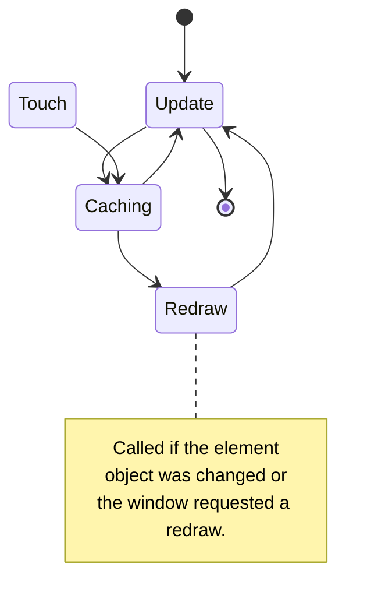

# Elements

Perform most of the functions required of the interface. The element processes user actions and changes based on them, switching its state or reporting an interaction to the window. Like any other component, the element is drawn on the canvas, but can also dynamically change its content.

## Life cycle



In addition to the standard background layout update, elements detect user touches, process bindings, and are cached for automatic self-updating.

Like other components, elements can be redrawn using the container's [invalidateElements](/api/namespace/UI#IWindow.invalidateElements) or [invalidateUIElements](/api/namespace/UI#Container.invalidateUIElements) function. This will immediately lead to the recaching of all elements, although usually a standard caching every half a second is quite enough for a stable update.

Some elements have their own events, they are directly related to user interactions, almost all (with the exception of inventory slots) also process touches, the description objects of which are given in the [corresponding paragraph](#common-properties).

## Element varieties

Components in elements are defined in the `elements` property of the window description object. Any element can be obtained by its identifier, changed, or bound to a global window property.

```js
new UI.Window({
    ...
    elements: {
        // component description object
        some_identifier: {
            type: "component", // required property
            ...
        },
        ...
    }
})
```

There can be any number of component description objects, the order of the elements in the object is also preserved during drawing.

:::tip Combine!

Most elements will look strange without each other. For example, how can you imagine a regular button without text. What should it do? Or maybe you would like to increase the size of the slot background without changing everything else? Use a combination of multiple elements.

:::

### Common properties

Unlike background layout elements, elements are based on a common prototype that sets a few basic life cycle and location properties. So as not to consider them in every element, let's highlight the common ones here.

Any element, in addition to the necessary property describing the type of component, must contain information about the location on the screen. For this, coordinates from the ordinate and abscissa are used:

```js
{
    ...
    x: 0, y: 0
}
```

Location, like other size values, are represented in units, let me remind you that this is 1/1000 of the window width. Despite the fact that the screen is two-dimensional, setting overlaps allows you to overlap elements behind you. The depth property is used for this:

```js
{
    ...
    z: 0
}
```

The larger its value, the closer the element. Use this property if you do not want to change the order of the elements or update the component after a while.

Clicking on an element leads to a corresponding event, a click:

```js
{
    ...
    onClick: function(container, window, component, location) {
        ...
    }
}
```

Here a container (if any), the window attached to it, the element itself and the point where the click was made relative to the element's location are provided. In addition to a standard click, this action handles holding. However, it is possible to handle holding separately without triggering a click event:

```js
{
    ...
    onLongClick: function(container, window, component, location) {
        ...
    }
}
```

But to more finely tune interaction with a component, you can process events yourself. The rest of the actions will still pass, use only the necessary types:

```js
{
    ...
    onTouchEvent: function(component, event) {
        switch (event.type.name()) {
            case "DOWN":
                // first touch to the component
                break;
            case "MOVE":
                // moving a finger over the component,
                // called every moment of touch
                // with the slightest gesture changes
                break;
            case "CLICK":
            case "LONG_CLICK":
                // standard click and hold events;
                // if called, the event end type
                // will not be called and will be overwritten
                break;
            case "UP":
            case "CANCEL":
                // interaction is finished or canceled
                // (canceled by system actions)
                break;
        }
    }
}
```

Consider [ITouchEvent](/api/namespace/UI#ITouchEvent) for details on available properties and methods of the `event` parameter.

### Images

<div className="resource-atlas-align-box">


</div>

Displays an image from the resources of the engine's interface folders, using the specified dimensions, or occupying the number of pixels in the image. Used for animations and displaying static elements.

```js
{
    type: "bitmap",
    x: 40, y: 0,
    bitmap: "icon_menu_innercore"
}
```

By default, images are drawn with the same number of pixels that are in the selected texture. To change this behavior, manually set the width and height:

```js
{
    ...
    width: 128,
    height: 128
}
```

Or change the scale by which the standard dimensions and position will be multiplied:

```js
{
    ...
    scale: 2.0
}
```

Among other things, images in elements can draw a picture over themselves:

```js
{
    ...
    overlay: "icon_mod_edit"
}
```

Then, the main `bitmap` will become something like a background image.

### Text

<div className="resource-atlas-align-box">


</div>

The only component for rendering text, allows you to configure the color, size and several style elements. The font used is [Minecraft (hy60koshk)](https://koshk.ru/koshkbench/?page=fonts), which includes basic characters and support for Cyrillic.

```js
{
    type: "text",
    x: 20, y: 40,
    text: "Hello"
}
```

All other properties are configured using a font object, which includes a number of options:

```js
{
    ...
    font: {
        color: android.graphics.Color.WHITE,
        // text size in units
        size: 20,
        // text alignment relative to its
        // position: top left (0), center (1),
        // bottom right (2), center right (3)
        alignment: 0,
        // text shadow offset, value from 0 to 1,
        // where zero means complete absence;
        // the larger the offset, the darker the shadow
        shadow: 0,
        bold: false, // thick or dense text
        cursive: false, // cursive italic text
        underline: false // underlined text
    }
}
```

Here are the default values, so just change the ones you need.

Unlike the [background layout](drawings#text), text as an element supports line breaks. Its settings determine the properties:

```js
{
    ...
    multiline: false, // handling hyphenation
    // whether the text needs to be additionally
    // processed before rendering, necessary for
    // the following property
    format: false,
    // the maximum number of characters on
    // one line, the rest will be
    // moved; requires multiline and format
    formatMaxCharsPerLine: 999
}
```

### Buttons

<div className="resource-atlas-align-box">


</div>

Buttons are an image that changes when interacted with. It has two states — passive and active; the latter is caused by hovering the cursor or finger, pressing and holding.

```js
{
    type: "button",
    x: 120, y: 40,
    bitmap: "classic_button_frame_up",
    bitmap2: "classic_button_frame_hover"
}
```

Even though any button is an image, it cannot be stretched by the engine. You must take care to prepare buttons of the desired sizes before displaying them, the `scale` parameter will help resize if necessary.

Consider [common properties](#common-properties) for defining events triggered by a button and other elements.

### Slots

<div className="resource-atlas-align-box">


</div>

In addition to the visual part, this element contains an item. Binding the window to the container will allow the player to interact with the slots, moving items into them from the inventory slots.

```js
{
    type: "slot",
    x: 240, y: 160,
    bitmap: "style:slot",
    size: 60
}
```

Texture is optional, as is the size, they are presented as default sizes. A slot consists of a background image, an image of the item itself, a text of its quantity and an outline overlay (when selecting this slot). This provides a number of properties for deeper customization:

```js
{
    ...
    // visual slots cannot be interacted with
    // in the usual way, but you can use common
    // events for your own slot logic implementation
    visual: false,
    // will darken the layer in any case, use
    // to indicate the desired item
    darken: false,
    // will darken the layer if there is no item in it,
    // but its identifier is specified
    isDarkenAtZero: true,
    // text of the item quantity, the quantity itself
    // will not be displayed
    text: null,
    // item scale relative to the slot
    iconScale: 0.82,
    // disabling pixel smoothing in the
    // item icon; enable for finer
    // tuning of the icon scale, but keep in mind that
    // on different screens the slot can "blur"
    disablePixelPerfect: false
}
```

The item is configured by the container itself (using bindings), or manually. In the latter case, it is recommended to make the layer visual using the property above, let's look at the item properties:

```js
{
    ...
    source: {
        id: VanillaItemID.diamond,
        data: 0,
        count: 64,
        extra: null
    }
}
```

It is enough to use only the identifier and the quantity, the rest of the properties are set automatically. Limit the stack size if the slot should output fewer items than it contains:

```js
{
    ...
    maxStackSize: 16
}
```

A value of 0 will mean a ban on interacting with the item, blocking it, -1 no restriction (default value). How to use containers to change a slot can be found in the [article about containers](TODO), this method is preferable in most cases.

Is there a need to determine when an item in a slot has been changed? Use the corresponding event:

```js
{
    ...
    onItemChanged: function(container, oldId, oldCount, oldData) {
        ...
    }
}
```

Add a method to restrict items that can be moved to the slot:

```js
{
    ...
    isValid: function(id, count, data, container, item) {
        ...
        return true;
    }
}
```

But note that once added to the container, items are saved, and this property will prohibit getting them as well, making the slot blocked.

### Scales

<div className="resource-atlas-align-box">


</div>

The scale is used to display progress, storage fullness level, the amount of accumulated energy, and other values. Use a [slider](#sliders) to change the value by the player, scales only display the value.

```js
{
    type: "scale",
    x: 40, y: 320,
    bitmap: "_liquid_water_texture_0",
    background: "_liquid_milk_texture_0",
    direction: 1
}
```

The `direction` property determines the direction of the scale, it can be: left-to-right (0, by default), bottom-to-top (1),
right-to-left (2) or top-to-bottom (3). Define the `value` property to set the value of this scale, as a fraction from 0 to 1.

By default, scales are drawn with the same number of pixels that are in the selected texture. To change this behavior, manually set the width and height:

```js
{
    ...
    width: 48,
    height: 240
}
```

Use the `scale` parameter to resize the element, it is identical to the property in the rest of the components.

Scales provide several textures at once to overlap each other in different scenarios using only one component. For this, in addition to the main scale, there is a background and an overlay:

```js
{
    ...
    background: "_liquid_milk_texture_0",
    backgroundOffset: { x: 0, y: 0 },
    overlay: "_liquid_empty_texture_0",
    overlayOffset: { x: 0, y: 0 }
}
```

And also several properties for describing the scale itself:

```js
{
    ...
    // pixelated scale smoothing
    pixelate: false,
    // inverts the visual value of the scale,
    // for example 0.3 will become 0.7
    invert: false
}
```

### Switches

<div className="resource-atlas-align-box">


</div>

A switch is a more complex implementation of a button, including a changeable state. Want a simpler explanation? Perhaps checkboxes or tick boxes are familiar to most. Switches are visually more noticeable, the mechanics are identical.

```js
{
    type: "switch",
    x: 600, y: 40
}
```

Specifying textures is not mandatory, the standard ones from the visual example will be used. If the main texture of any of the states is changed, then the hover texture must also be used. Otherwise, holding and other interactions will not be visualized:

```js
{
    ...
    bitmapOn: "default_switch_on",
    bitmapOnHover: "default_switch_on_hover",
    bitmapOff: "default_switch_off",
    bitmapOffHover: "default_switch_off_hover"
}
```

Specially for managing the state of the switch, several methods of its synchronization and manual change are provided. In general, the state property will suit most:

```js
{
    ...
    state: false
}
```

In addition to this property, the state can be tied to a value in the config, then its saving will occur automatically:

```js
{
    ...
    configValue: __config__.getValue("some_property")
}
```

Or to a property in an object, it will also be changed by the switch:

```js
const PROPERTIES = {
    ...
    myBool: true
}
```

```js
{
    ...
    bindingObject: PROPERTIES,
    bindingProperty: "myBool" // default is "on"
}
```

Monitor the state change using the corresponding event:

```js
{
    ...
    onNewState: function(value, container, component) {
        ...
    }
}
```

Use the `scale` parameter to resize the element, it is identical to the property in the rest of the components.

### Sliders

<div className="resource-atlas-align-box">


</div>

By touching anywhere on the slider, its value will be changed and the pointer will move to a new place. Sliders can be used for completely different purposes, not even necessarily for numerical values.

```js
{
    type: "scroll",
    x: 80, y: 200,
    width: 64,
    length: 500
}
```

The `width` property will determine the height of the slider, the `length` will determine its length. Why is the slider called "scroll" and not "seek"? Ask [Zheka](https://vk.me/id24708057).

Specifying textures is not mandatory, the standard ones from the visual example will be used. If the main texture of any of the states is changed, then the hover texture must also be used. Otherwise, holding and other interactions will not be visualized:

```js
{
    ...
    bitmapHandle: "default_scroll_handle",
    bitmapHandleHover: "default_scroll_handle_hover",
    bitmapBg: "default_scroll_bg",
    bitmapBgHover: "default_scroll_bg_hover",
    ratio: 0.6
}
```

The `ratio` property must be overridden if the background texture changes, it is a [frame](#stretchable-frames) stretched in width by this property.

Override the intervals of values determined by the slider:

```js
{
    ...
    min: 0,
    max: 1,
    // number of steps the slider can take
    // from minimum to maximum value
    divider: 1000
}
```

Specially for managing the slider value, several methods of its synchronization and manual change are provided. In general, the value property will suit most:

```js
{
    ...
    value: 0
}
```

In addition to this property, the value can be tied to a value in the config, then its saving will occur automatically:

```js
{
    ...
    configValue: __config__.getValue("some_property")
}
```

Or to a property in an object, it will also be changed by the slider:

```js
const PROPERTIES = {
    ...
    myNumber: 0.3
}
```

```js
{
    ...
    bindingObject: PROPERTIES,
    bindingProperty: "myNumber" // default is "value"
}
```

Monitor the value change using the corresponding event:

```js
{
    ...
    onNewValue: function(value, container, component) {
        ...
    }
}
```

The slider can process integer values rather than fractions. In this case, override the minimum and maximum values, the step will be automatically overridden to one. Use the property:

```js
{
    ...
    isInt: true
}
```

### Stretchable frames

<div className="resource-atlas-align-box">


</div>

Unlike images, frames allow you to divide pictures into eight parts to stretch four of them, without changing the proportions of the picture's edges.

```js
{
    type: "frame",
    x: 60, y: 120,
    bitmap: "style:frame_header",
    width: 80, height: 26
}
```

Similar to `scale` in images, the scale affects the display of the entire frame. Use this property to determine the thickness of the frame, usually textures from modifications on Forge use a value of 2.

:::info How it works

During loading, the image is divided into eight parts, not counting the central one.

<table className="block-uv-table">
    <tr>
        <td>edge</td>
        <td>side</td>
        <td>edge</td>
    </tr>
    <tr>
        <td>side</td>
        <td/>
        <td>side</td>
    </tr>
    <tr>
        <td>edge</td>
        <td>side</td>
        <td>edge</td>
    </tr>
</table>

Each part is scaled due to the `scale` property, after which the sides stretched in width and height, intact edges and the central color are drawn.

The central color fills the most space, is determined by the `color` property, or automatically.

:::

It is not necessary to draw all sides of the frame. For example, for vertical tabs, you can skip its lower part:

```js
{
    ...
    sides: {
        down: false
    }
}
```

And any of the sides `up`, `left` or `right`, setting their value to `false`.

:::note Similar implementations

The frames here are similar in principle to [ninepatch (9-patch)](https://developer.android.com/studio/write/draw9patch), used in Android. Study this article for an in-depth understanding of the frame processing mechanism, how pictures are cut into parts and then glued together into a solid image.

The engine uses its own processing and you cannot simply use patches as input pictures. However, there are no restrictions on using the system packages, so you can simply process the images at the preload stage to display them.

:::

### Remaining components

This is not a complete list of elements, but only its unique parts. For example, slots are divided into regular and inventory-bound, and in addition to a regular button, there is a close button. Based on the templates from this article, they are described in [extending components](advanced/extending-components#built-in-implementations).
