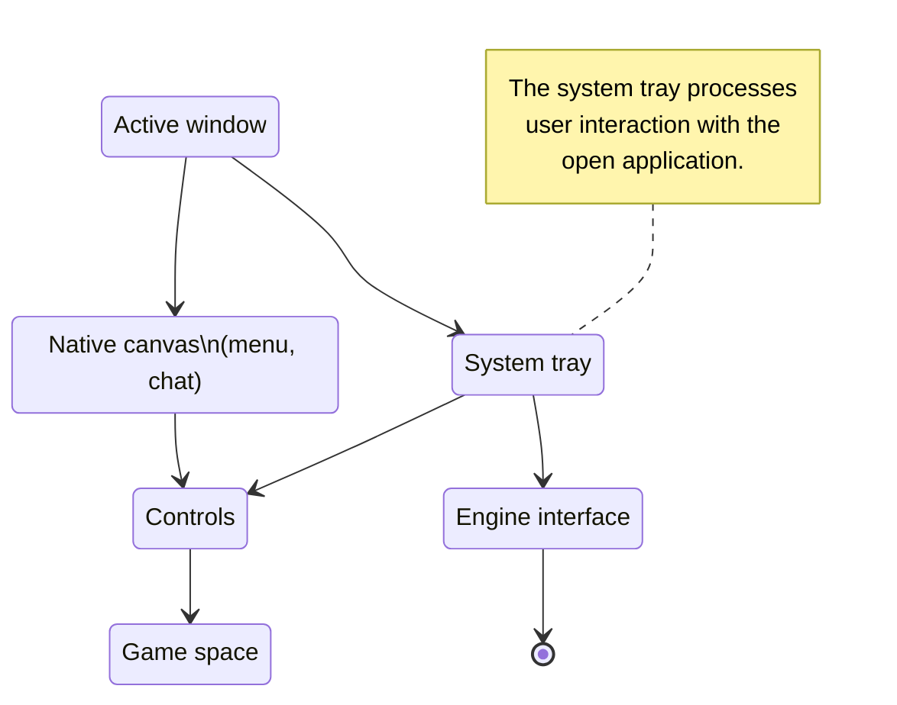
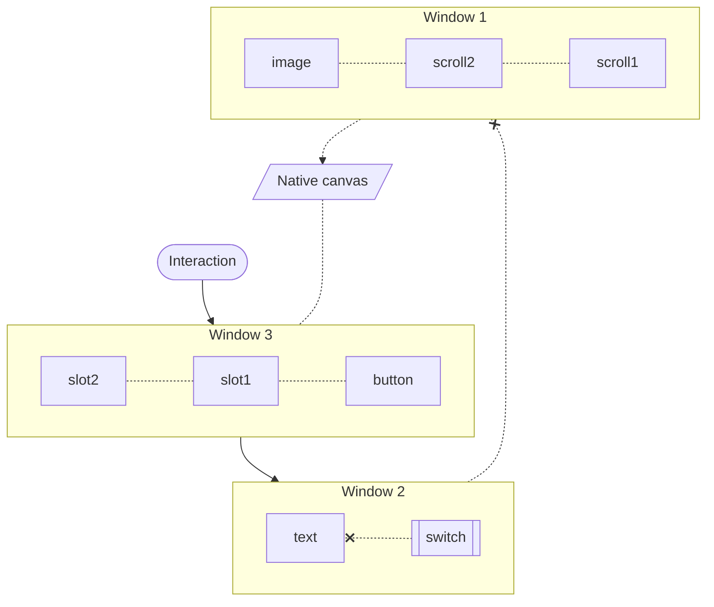

# Investigating contents

The interface in Inner Core is built on the basis of the Android graphical shell, all elements of which are drawn on a single canvas for each window. Displaying occurs on top of the gameplay, which does not allow modifying the in-game interface, but extends the capabilities of working with content.

## Structure

Without going into details, there is a game space and content around it (controller, various menus, as well as windows opened by mods).

The output point is exactly the content opened by mods. Depending on the window type, the content can either cover the entire screen area or serve only as an auxiliary control element.

## Open windows

They consist of content, which includes a background layout and main elements above it. The content itself includes a conductor in the form of a container, it is needed to store data and work with the inventory. Such a structure is used for each window, elements are dynamically and automatically updated when changed.

### Background layout

As the name implies, it serves as a layer under the main content. You cannot interact with the components here, and they are mostly static.

Usually, the window frame, strokes for transparent slots, scales, and other things are located here.

### Elements

The content itself, it will be located above all other layers of this window, and the user will be able to interact with it. Buttons, switches, and slots are just a small part of what can be located here.

### Container

Containers serve as a wrapper for the window, they control its life cycle and carry out operations with slots.

If you open windows directly, without using a container, the player will not be able to interact directly with the slots. Although there are situations when a container is not really needed, for example, a couple of buttons in an auxiliary game window.

## Interaction

What do we mean by interaction? Any press, pinch, swipe, and even a simple touch to the screen are considered such. Do not forget about the keyboard and mouse.

Before the device can understand what exactly the interaction occurred with, it is necessary to go through the hierarchy of open windows and elements in them. The highest priority is given to windows opened most recently, and elements added after the rest.

Windows that can be interacted with will in any case overlap all the content behind them. Imagine sheets of paper lying on top of each other. The interface windows here are roughly the same sandwich.
